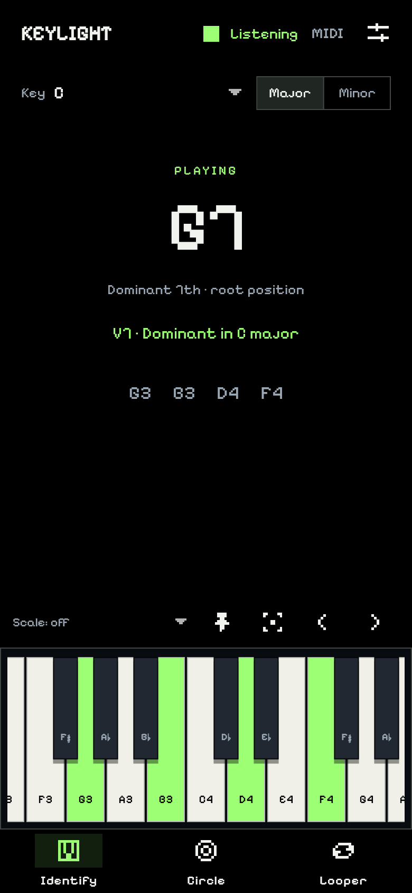
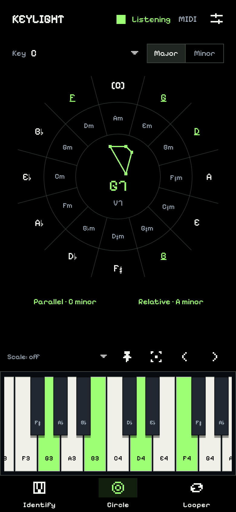
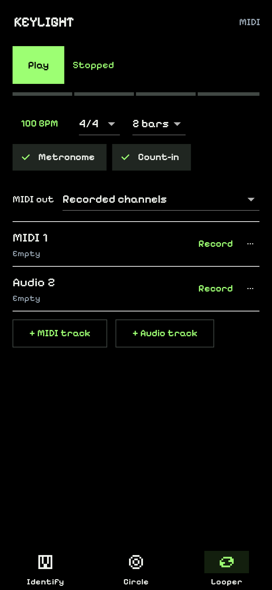

# Keylight

Play a chord on your piano and see how it fits the key. Keylight is a Flutter practice app for Android and iOS with live chord identification, an interactive circle of fifths, and a multitrack looper.

| Identify | Circle of fifths | Looper |
| :---: | :---: | :---: |
|  |  |  |

## Features

- **Identify what you play.** Choose a key to see note names, chords, inversions, Roman numerals, and harmonic functions. The 88-key keyboard keeps your last voicing visible after you release it.
- **Explore the circle of fifths.** Follow the notes of a chord around the circle, switch between relative and parallel keys, and highlight scales on the keyboard.
- **Connect your piano.** Use the microphone for on-device polyphonic detection or connect a keyboard over USB or Bluetooth MIDI. Microphone accuracy varies with the piano and room.
- **Loop a phrase and play along.** Layer MIDI and microphone tracks with a metronome, count-in, and selectable time signatures. Send MIDI back to your instrument with the recorded velocities and pedal movements. Loops last for the current session.

## Run on a phone

Use Flutter 3.50.0 and a connected Android phone (API 26+) or iPhone (iOS 15+). Android builds require the Android SDK. Building for iOS requires macOS, Xcode, CocoaPods, and a signing team in `ios/Runner.xcworkspace`. The Android build has been verified. The iOS build still needs device testing.

```sh
flutter pub get
flutter devices
flutter run --profile -d <device-id>
```

Tap **Listen** for microphone input or **MIDI** to choose your instrument.

[Theory tools](docs/theory_tools.md) · [MIDI and looper guide](docs/looper.md) · [Microphone model and validation](docs/polyphonic_detection.md)

## Development

Run `flutter analyze` and `flutter test` from the project root. Linux host tests need Clang to compile the native audio engine. To check metronome timing with an audio output, run `flutter test --dart-define=METRONOME_MIXER_TEST=true test/metronome_mixer_test.dart`.

The bundled Magenta piano model and the Pixelify Sans and Noto Music fonts include their upstream notices. [Model attribution](assets/models/README.md) · [Pixelify Sans license](assets/fonts/Pixelify-OFL.txt) · [Noto Music license](assets/fonts/OFL.txt)
